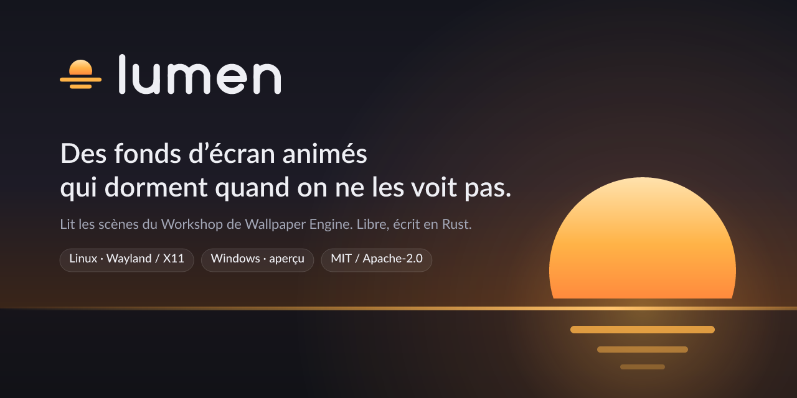
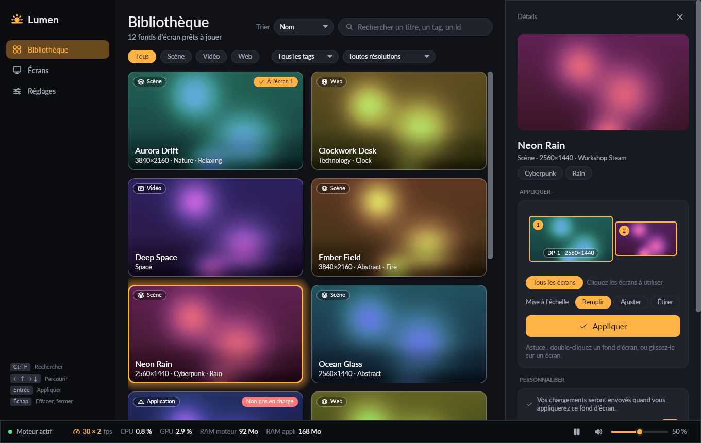
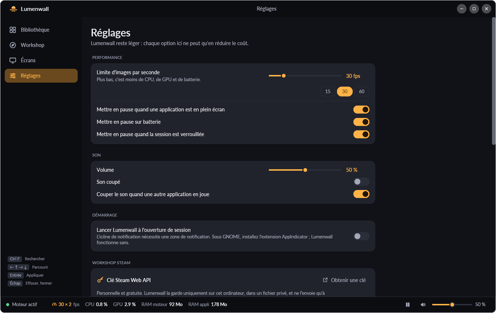
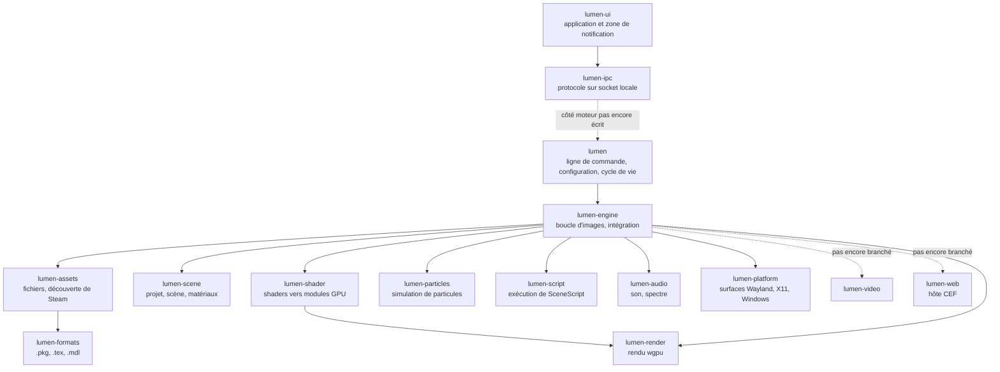

<p align="center">
  
</p>

<p align="center">
  <a href="https://github.com/simnJS/lumen/actions/workflows/ci.yml"></a>
  <a href="#licence"></a>
  
  
</p>

<p align="center"><a href="README.md">English</a> · <b>Français</b></p>

**Lumen affiche les scènes du Workshop de Wallpaper Engine en fond d’écran sous Linux et Windows, avec un moteur natif en Rust qui ne dessine une image que lorsque quelque chose change à l’écran, et rien du tout quand le bureau est caché.**

> [!NOTE]
> Lumen est en début de développement et n’a pas encore de version publiée. Les fonds d’écran de type scène fonctionnent aujourd’hui sous Linux. La vidéo, le web, la liaison entre l’application de bureau et le moteur, et Windows à l’exécution ne sont pas terminés : voir [Fonctionnalités](#fonctionnalités).

## Sommaire

- [Captures d’écran](#captures-décran)
- [Performances](#performances)
- [Fonctionnalités](#fonctionnalités)
- [Installation](#installation)
- [Utilisation](#utilisation)
- [FAQ](#faq)
- [Architecture](#architecture)
- [Contribuer et règles de salle blanche](#contribuer-et-règles-de-salle-blanche)
- [Licence](#licence)
- [Mentions légales](#mentions-légales)

## Captures d’écran

L’application de bureau, `lumen-ui`, avec sa bibliothèque de démonstration générée (`lumen-ui --demo-library --fake-daemon`). Aucun contenu du Workshop n’apparaît.

<p align="center">
  
  
</p>

D’autres captures dans [`docs/ui-screenshots/`](docs/ui-screenshots/) ; notes de conception dans [`docs/UI.md`](docs/UI.md) (en anglais).

## Performances

La performance passe en premier : un fond d’écran identique mais plus coûteux est une régression ([`docs/PERFORMANCE.md`](docs/PERFORMANCE.md)). Les chiffres ci-dessous viennent des README des crates, où chacun est noté avec sa méthode.

**Machine et conditions.** AMD Ryzen 9 7950X3D, NVIDIA GeForce RTX 4080 SUPER (pilote propriétaire, Vulkan), Ubuntu 26.04, session Wayland GNOME 50.1 (Lumen y dessine via XWayland). Compilation release, limite à 30 i/s. Fond d’écran de référence : une scène du Workshop en 3440×1440 avec 11 effets, 4 systèmes de particules et un son ([`docs/TESTING.md`](docs/TESTING.md)).

| Situation | Mesure | Source |
|---|---|---|
| Fond d’écran sur deux écrans 2560×1440 | 30,0 i/s, **1,6 % d’un cœur**, 240 Mio de RSS (49 Mio privés, le reste est fait des bibliothèques du pilote et de l’archive projetée en mémoire), 268 Mio de VRAM | [lumen-engine](crates/lumen-engine/README.md#measurements-rtx-4080-super-vulkan-release-reference-wallpaper-34401440-scene) |
| Une image, fenêtre 1720×720 | CPU 0,4–0,6 ms ; GPU **0,5 ms** à pleine fréquence (sans affichage), 0,8–4,7 ms quand le GPU reste à ses fréquences de repos | lumen-engine |
| Chargement de la scène (13 textures, 23 passes de shader depuis le cache, 4 systèmes de particules) | **80–230 ms** | lumen-engine |
| Fenêtre plein écran au-dessus | En pause : 0 image, 0,2 % d’un cœur (fil du son) | lumen-engine |
| Écran couvert par une fenêtre Wayland plein écran (GNOME) | Pause ≈1,3 s après l’apparition de la fenêtre, reprise ≈30 ms après sa fermeture ; pendant ce temps 0 image, ≈2 réveils par seconde | [lumen-platform](crates/lumen-platform/README.md#gnome-wayland-session-x11-windows-through-xwayland) |
| Au repos, aucune image demandée (X11, mode fenêtre) | **0 réveil** du fil d’événements en 3 s | [lumen-platform](crates/lumen-platform/README.md#performance) |
| Image en régime établi | **0 allocation** sur le tas dans les chemins par image de Lumen : mise à jour du rendu, particules, marionnettes, scripts (tests avec allocateur compteur ; wgpu alloue en interne en enregistrant les commandes) | [lumen-render](crates/lumen-render/README.md), [lumen-particles](crates/lumen-particles/README.md), lumen-engine |
| Animation de marionnettes, 16 squelettes et 78 os | 8,5–9 µs de CPU par image | lumen-engine |
| SceneScript, 20 scripts et 7 calques de texte | 10–18 µs par image | lumen-engine |
| Traduction des 23 passes de shader de la scène | 1,9 ms sur 32 fils ; ≈30 µs par passe depuis le cache disque | [lumen-shader](crates/lumen-shader/README.md) |
| Application de bureau au repos, 32 fonds d’écran / processus de la zone de notification | 0,0 % de CPU / 10 Mo de RSS | [docs/UI.md](docs/UI.md) |

Mesurez sur votre machine avec `LUMEN_STATS=1 lumen <id>` : i/s, temps CPU et GPU par image et mémoire, toutes les 5 secondes.

## Fonctionnalités

✅ fonctionne et a été testé sur la machine de développement · 🚧 partiel ou en cours · ⏳ pas commencé, ou pas encore testé

**Fonds d’écran**

| | Fonctionnalité | Notes |
|---|---|---|
| ✅ | Scènes | Images avec leurs chaînes d’effets et les shaders du fond d’écran, bloom, LUT de couleur, parallaxe de caméra, propriétés utilisateur (`--set-property`, rechargement à chaud) |
| ✅ | Particules | Sprites, traînées, cordes, systèmes enfants |
| ✅ | SceneScript | Scripts de propriétés, minuteries, événements, curseur. 🚧 La création de calques à l’exécution n’est pas encore prise en charge |
| ✅ | Animation de marionnettes | Squelettes, couches d’animation, skinning sur GPU, attaches. 🚧 Ni physique, ni cinématique inverse, ni blend shapes |
| ✅ | Calques de texte | La police du fond d’écran, textes scriptés comme les horloges. 🚧 Ni contour, ni ombre, ni fond |
| ✅ | Son et effets réactifs à l’audio | Sons de la scène, spectre audio capturé depuis PulseAudio (ou le serveur Pulse de PipeWire), coupure automatique quand une autre application joue |
| 🚧 | Vidéo | En cours : décodage matériel avec envoi au GPU sans copie conçu ([`docs/research/platform.md`](docs/research/platform.md)) ; la crate `lumen-video` est encore vide |
| 🚧 | Web | Hôte Chromium (CEF) et API web de Wallpaper Engine écrits, pas encore compilés ni branchés |
| 🚧 | Listes de lecture | Seul le premier élément est joué |
| 🚧 | Un fond d’écran sur plusieurs écrans | Chaque écran affiche le fond d’écran entier |

**Bureau**

| | Fonctionnalité | Notes |
|---|---|---|
| ✅ | GNOME (session Wayland), sans extension | Fenêtres de bureau X11 via XWayland ; pause sous les fenêtres plein écran et couvrantes (mesuré sur GNOME 50.1) |
| ✅ | X11 | Testé via XWayland seulement, pas encore sur une session Xorg native |
| 🚧 | Wayland layer-shell : KDE Plasma, sway, Hyprland, niri, COSMIC | Implémenté, pas encore testé sur ces compositeurs |
| ⏳ | Windows 10 et 11 | Compile et passe les tests en CI (DX12 sur l’adaptateur logiciel WARP) ; jamais lancé sur un vrai bureau Windows |
| ✅ | Pause quand le bureau est caché | Plein écran et écrans couverts mesurés ; verrouillage et écran éteint implémentés, non vérifiés |
| ✅ | Fichier de configuration rechargé à chaud | i/s et propriétés appliqués sans redémarrer |
| 🚧 | Application de bureau (`lumen-ui`) et zone de notification | Bibliothèque, écrans, réglages, édition des propriétés en direct ; ne fonctionne qu’avec le démon de démonstration, car `lumen` ne répond pas encore au protocole de l’application |
| 🚧 | Navigateur du Workshop dans l’application | En cours |
| ⏳ | Paquets (Flatpak, AUR, installateur Windows) | Aucun pour l’instant : compilez depuis les sources |

## Installation

**Il vous faut :**

- **Wallpaper Engine**, acheté et installé via Steam, avec les fonds d’écran voulus abonnés dans le Workshop. Lumen lit les éléments du Workshop et le dossier `assets` de Wallpaper Engine là où ils sont, et n’en distribue aucun fichier. Sous Linux, installez Wallpaper Engine avec Steam Play (Proton) activé pour lui ; Lumen ne le lance jamais.
- **Rust 1.90 ou plus récent** ([rustup](https://rustup.rs)).
- **Un pilote Vulkan** sous Linux (Mesa ou NVIDIA), DirectX 12 sous Windows.
- **Les bibliothèques de compilation Linux**, d’après l’arbre des dépendances (compilateur C pour QuickJS, ALSA, PulseAudio) :
  - Debian, Ubuntu : `sudo apt install build-essential pkg-config libasound2-dev libpulse-dev`
  - Fedora : `sudo dnf install gcc pkgconf-pkg-config alsa-lib-devel pulseaudio-libs-devel`
  - Arch : `sudo pacman -S base-devel alsa-lib libpulse`

  La CI installe un ensemble plus large, pour toutes les crates et options : [`.github/actions/setup-rust/action.yml`](.github/actions/setup-rust/action.yml).

**Installer depuis le dépôt** (la crate `lumen` de crates.io est un autre projet) :

```bash
cargo install --locked --git https://github.com/simnJS/lumen lumen
cargo install --locked --git https://github.com/simnJS/lumen lumen-ui   # facultatif : aperçu de l’application
```

**Démarrer avec la session (Linux).** Choisissez le fond d’écran dans le fichier de configuration, puis copiez l’entrée de démarrage automatique et les icônes :

```bash
git clone https://github.com/simnJS/lumen && cd lumen
mkdir -p ~/.config/lumen ~/.config/autostart ~/.local/share/icons
printf 'wallpaper = "<id-workshop>"\n' > ~/.config/lumen/config.toml
cp packaging/linux/lumen.desktop ~/.config/autostart/
cp -r packaging/linux/icons/hicolor ~/.local/share/icons/
```

GNOME, KDE, XFCE et les autres bureaux lancent `lumen` à l’ouverture de session depuis `~/.config/autostart`. Supprimez le fichier pour arrêter. Modifier `config.toml` pendant que Lumen tourne applique aussitôt les changements d’i/s et de propriétés.

**Compiler depuis les sources :**

```bash
git clone https://github.com/simnJS/lumen && cd lumen
cargo build --release --locked          # target/release/lumen et target/release/lumen-ui
```

L’ensemble des vérifications (format, clippy, tests, tests GPU sur adaptateur logiciel, `cargo deny`) est décrit dans [`docs/CI.md`](docs/CI.md).

## Utilisation

```bash
lumen <id-workshop>                         # sur tous les écrans ; un id du Workshop ou un dossier
lumen ~/fonds/ma-scene                      # un dossier qui contient project.json
lumen -r DP-1 -b <id-1> -r HDMI-A-1 -b <id-2>   # un fond d’écran par écran
lumen --fps 60 --scaling fill <id>
lumen --list-properties <id>                # les propriétés utilisateur du fond d’écran
lumen --set-property rain=0 <id>            # en forcer une (répétable)
lumen -w 0x0x1280x720 <id>                  # dans une fenêtre, pour tester
LUMEN_STATS=1 lumen <id>                    # i/s, temps CPU/GPU par image, mémoire
```

| Option | Effet |
|---|---|
| `-r`, `--screen-root <sortie>` | Mode bureau sur cet écran ; les options suivantes s’y appliquent. Répétable |
| `-b`, `--bg <id ou chemin>` | Fond d’écran de l’écran courant |
| `--scaling stretch\|fit\|fill\|default` | Façon dont le fond d’écran remplit l’écran |
| `-f`, `--fps <n>` | Limite d’images par seconde (30 par défaut) |
| `-v`, `--volume <0–128>` / `-s`, `--silent` | Volume du son (15 par défaut) / muet |
| `--noautomute` | Garder le son quand une autre application en joue |
| `--no-fullscreen-pause` | Continuer le rendu sous les fenêtres plein écran |
| `--disable-particles`, `--disable-mouse`, `--disable-parallax` | Désactiver ces fonctions |
| `--assets-dir <dossier>` | Dossier `assets` de Wallpaper Engine, s’il n’est pas trouvé automatiquement |
| `--screenshot <fichier.png>` | Enregistrer une image après quelques images |
| `--config <fichier>`, `--no-config` | Utiliser un autre fichier de configuration, ou aucun |

Toutes les options, le format du fichier de configuration (`~/.config/lumen/config.toml`, `%APPDATA%\Lumen\config.toml` sous Windows) et les codes de sortie sont dans [`crates/lumen/README.md`](crates/lumen/README.md) (en anglais). Les options de l’application de bureau sont dans [`crates/lumen-ui/README.md`](crates/lumen-ui/README.md).

## FAQ

**Faut-il posséder Wallpaper Engine ?**
Oui. Steam télécharge les fonds d’écran du Workshop dans le dossier Workshop de Wallpaper Engine, et les scènes utilisent les shaders et matériaux du dossier `assets` de Wallpaper Engine. Lumen lit ces fichiers là où Steam les a mis et n’en contient aucun.

**Lumen est-il affilié à Wallpaper Engine ou à Valve ?**
Non. Lumen est un projet libre indépendant, ni soutenu ni approuvé par les développeurs de Wallpaper Engine ou par Valve.

**Est-ce que ça marche sous GNOME sans extension ?**
Oui. GNOME n’a pas de layer-shell : Lumen utilise des fenêtres de bureau X11 via XWayland et détecte les écrans couverts grâce au rythme d’affichage du compositeur. Mesuré sur GNOME 50.1 avec un GPU NVIDIA.

**Et KDE Plasma, sway, Hyprland ?**
Le moteur layer-shell est écrit mais n’a pas encore tourné sur ces compositeurs. Vos retours sont bienvenus (modèle de rapport de bug).

**Et Windows ?**
Lumen compile et passe ses tests sous Windows en CI, mais n’a jamais tourné sur un bureau Windows. La liste des points à vérifier est dans [`crates/lumen-platform/README.md`](crates/lumen-platform/README.md#to-check-on-windows-11-24h2--25h2-and-once-on-windows-10).

**Combien ça coûte pendant que je joue ?**
Une fenêtre plein écran met le rendu en pause : 0 image, 0,2 % d’un cœur mesuré (le fil du son). `--no-fullscreen-pause` désactive ce comportement.

**Pourquoi l’application dit-elle que le moteur est arrêté ?**
L’application de bureau parle au moteur par une socket locale, et la partie moteur de ce protocole n’est pas encore écrite. D’ici là, l’application est un aperçu qui fonctionne avec son démon de démonstration.

**Lumen est-il dérivé d’une autre réimplémentation de Wallpaper Engine ?**
Non. Il est écrit à partir de spécifications de comportement selon un processus de salle blanche, ce qui permet la licence MIT OR Apache-2.0 ([`CLEANROOM.md`](CLEANROOM.md)).

## Architecture



Le README de chaque crate liste les spécifications dont elle est issue, ses mesures et ses écarts par rapport au comportement de référence ([`docs/PARITY-POLICY.md`](docs/PARITY-POLICY.md)).

## Contribuer et règles de salle blanche

Les contributions sont bienvenues. Lisez d’abord [`CONTRIBUTING.md`](CONTRIBUTING.md) ; l’essentiel :

- **Salle blanche.** Le code est écrit à partir des spécifications de `specs/` et de la documentation publique uniquement. Ne jamais lire, copier ni adapter le code de réimplémentations GPL ou AGPL de Wallpaper Engine ni de leurs forks ([`CLEANROOM.md`](CLEANROOM.md)).
- **Aucun contenu de Wallpaper Engine dans le dépôt** : ni fichiers du Workshop, ni aperçus, ni assets, même comme données de test ([`docs/TESTING.md`](docs/TESTING.md)).
- **La performance est une fonctionnalité** : aucune allocation par image, aucune scrutation, aucun travail quand rien n’est visible ([`docs/PERFORMANCE.md`](docs/PERFORMANCE.md)).
- **Uniquement des dépendances sous licence permissive**, vérifié par `cargo deny` ([`deny.toml`](deny.toml)).
- La marque, les couleurs, les icônes et les captures suivent [`docs/BRAND.md`](docs/BRAND.md).

## Licence

Distribué au choix sous [licence Apache 2.0](LICENSE-APACHE) ou [licence MIT](LICENSE-MIT).

Sauf mention contraire explicite de votre part, toute contribution que vous soumettez intentionnellement pour inclusion dans Lumen, au sens de la licence Apache-2.0, est placée sous la double licence ci-dessus, sans conditions supplémentaires.

## Mentions légales

Lumen n’est ni affilié aux développeurs de Wallpaper Engine ni à Valve Corporation, ni approuvé ou parrainé par eux. Wallpaper Engine est une marque de son propriétaire. Steam et le logo Steam sont des marques commerciales et/ou des marques déposées de Valve Corporation aux États-Unis et/ou dans d’autres pays. Les fonds d’écran du Workshop sont l’œuvre de leurs auteurs ; Lumen ne les distribue pas et ne les télécharge pas.
