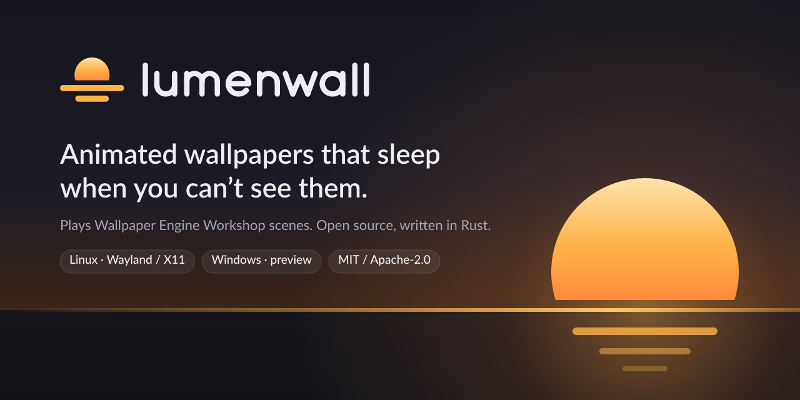
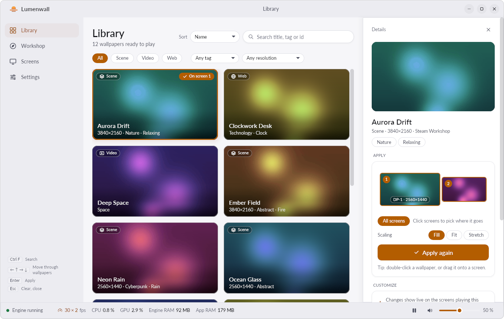
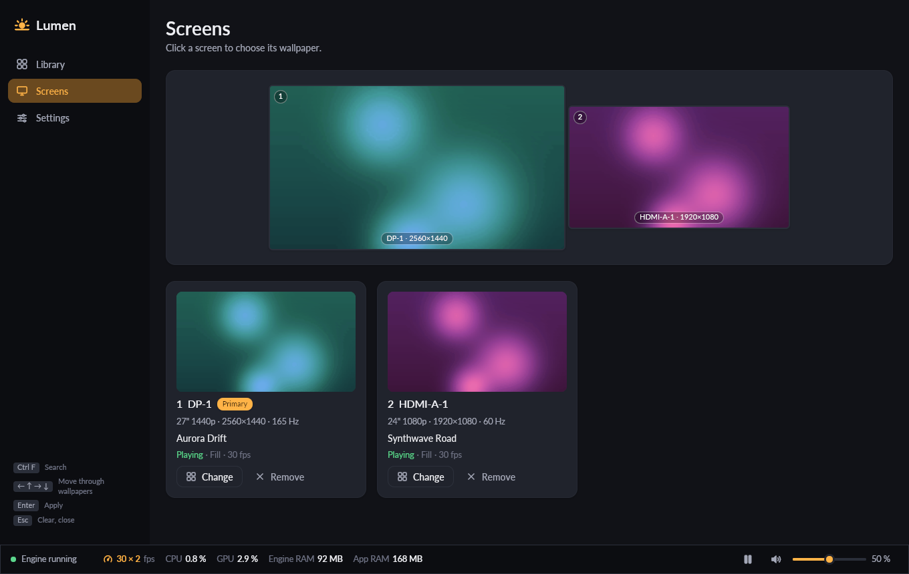
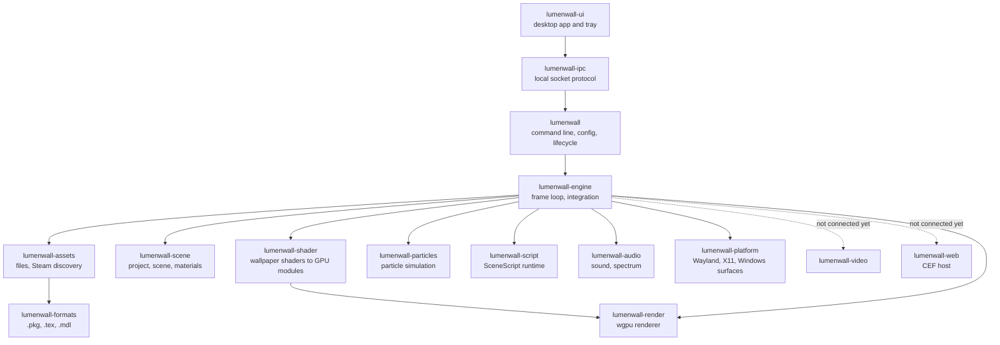

<p align="center">
  
</p>

<p align="center">
  <a href="https://github.com/simnJS/lumenwall/actions/workflows/ci.yml"></a>
  <a href="#license"></a>
  
  
</p>

<p align="center"><b>English</b> · <a href="README.fr.md">Français</a></p>

**Lumenwall plays Wallpaper Engine Workshop scenes as your desktop wallpaper on Linux and Windows, with a native Rust engine that draws a frame only when something on screen changes, and nothing at all when the desktop is hidden.**

> [!NOTE]
> Lumenwall is in early development and has no release yet. Scene, video and web wallpapers and the desktop app run on Linux today. Windows at runtime is not done: see [Features](#features).

## Contents

- [Screenshots](#screenshots)
- [Performance](#performance)
- [Features](#features)
- [Installation](#installation)
- [Usage](#usage)
- [FAQ](#faq)
- [Architecture](#architecture)
- [Contributing and clean-room rules](#contributing-and-clean-room-rules)
- [License](#license)
- [Legal](#legal)

## Screenshots

The desktop app, `lumenwall-ui`, with its generated demo library (`lumenwall-ui --demo-library --fake-daemon`). No Workshop content is shown.

<p align="center">
  
  
</p>

More in [`docs/ui-screenshots/`](docs/ui-screenshots/); design notes in [`docs/UI.md`](docs/UI.md).

## Performance

Performance comes first: a wallpaper that looks the same but costs more is treated as a regression ([`docs/PERFORMANCE.md`](docs/PERFORMANCE.md)). The figures below come from the crate READMEs, where each one is recorded with its method.

**Machine and conditions.** AMD Ryzen 9 7950X3D, NVIDIA GeForce RTX 4080 SUPER (proprietary driver, Vulkan), Ubuntu 26.04, GNOME 50.1 Wayland session (Lumenwall draws through XWayland there). Release build, 30 fps cap. Reference wallpaper: a 3440×1440 Workshop scene with 11 effects, 4 particle systems and a sound ([`docs/TESTING.md`](docs/TESTING.md)).

| Situation | Measured | Source |
|---|---|---|
| Desktop wallpaper on two 2560×1440 screens | 30.0 fps, **1.6 % of one CPU core**, 240 MiB RSS (49 MiB private, the rest is driver libraries and the mapped archive), 268 MiB VRAM | [lumenwall-engine](crates/lumenwall-engine/README.md#measurements-rtx-4080-super-vulkan-release-reference-wallpaper-34401440-scene) |
| One frame, 1720×720 window | CPU 0.4–0.6 ms; GPU **0.5 ms** at full clocks (headless), 0.8–4.7 ms when the GPU stays at its low idle clocks | lumenwall-engine |
| Loading the scene (13 textures, 23 shader passes from the cache, 4 particle systems) | **80–230 ms** | lumenwall-engine |
| Fullscreen window on top | Paused: 0 frames, 0.2 % of one core (sound thread) | lumenwall-engine |
| Screen covered by a fullscreen Wayland window (GNOME) | Pauses ≈1.3 s after the window appears, resumes ≈30 ms after it closes; while covered 0 frames, ≈2 wake-ups per second | [lumenwall-platform](crates/lumenwall-platform/README.md#gnome-wayland-session-x11-windows-through-xwayland) |
| Idle, no frame requested (X11, window mode) | **0 wake-ups** of the event thread over 3 s | [lumenwall-platform](crates/lumenwall-platform/README.md#performance) |
| Steady-state frame | **0 heap allocations** in Lumenwall's per-frame paths: renderer update, particles, puppets, scripts (counting-allocator tests; wgpu allocates internally when recording commands) | [lumenwall-render](crates/lumenwall-render/README.md), [lumenwall-particles](crates/lumenwall-particles/README.md), lumenwall-engine |
| Puppet animation, 16 skeletons and 78 bones | 8.5–9 µs of CPU per frame | lumenwall-engine |
| SceneScript, 20 scripts and 7 text layers | 10–18 µs per frame | lumenwall-engine |
| Translating the 23 shader passes of the scene | 1.9 ms on 32 threads; ≈30 µs per pass from the disk cache | [lumenwall-shader](crates/lumenwall-shader/README.md) |
| Desktop app idle, 32 wallpapers / tray process | 0.0 % CPU / 10 MB RSS | [docs/UI.md](docs/UI.md) |

Measure on your machine with `LUMENWALL_STATS=1 lumenwall <id>`: fps, CPU and GPU time per frame and memory, every 5 seconds.

## Features

✅ works and was tested on the development machine · 🚧 partial or in progress · ⏳ not started, or not tested yet

**Wallpapers**

| | Feature | Notes |
|---|---|---|
| ✅ | Scene wallpapers | Images with their effect chains and the wallpaper's own shaders, bloom, colour LUTs, camera parallax, user properties (`--set-property`, live reload) |
| ✅ | Particles | Sprites, trails, ropes, child systems |
| ✅ | SceneScript | Property scripts, timers, events, cursor. 🚧 Creating layers at run time is not supported yet |
| ✅ | Puppet animation | Skeletons, animation layers, GPU skinning, attachments. 🚧 No physics, inverse kinematics or blend shapes |
| ✅ | Text layers | The wallpaper's font, scripted text such as clocks. 🚧 No outline, shadow or background box |
| ✅ | Sound and audio-reactive effects | Scene sounds, audio spectrum captured from PulseAudio (or PipeWire's Pulse server), automatic mute when another app plays |
| ✅ | Video wallpapers | Hardware decoding with Vulkan Video on the render device, zero copy (≈2.5 % of one core for 4K60 H.264 at 30 fps); NVDEC, VA-API, D3D11VA and software fallbacks; looped sound. 🚧 Videos inside scenes, HDR, 10-bit zero copy |
| ✅ | Web wallpapers | Offscreen Chromium (CEF) in a separate process, frames shared with the GPU (DMA-BUF, zero copy; shared-memory fallback), the Wallpaper Engine web API (user properties, audio listener, pause), mouse and clicks, page sound under `--volume`/`--silent`; pages that stop changing cost no frame, paused pages are frozen (≈0.5 % of one core). Needs the optional host build below. 🚧 Linux only (no Direct3D import yet), no media integration source, automute does not apply to the page |
| 🚧 | Playlists | Only the first item plays |
| 🚧 | One wallpaper spanning several screens | Each screen shows the whole wallpaper |

**Desktop**

| | Feature | Notes |
|---|---|---|
| ✅ | GNOME (Wayland session), no extension | X11 desktop windows through XWayland; pauses under fullscreen and covering windows (measured on GNOME 50.1) |
| ✅ | X11 | Tested through XWayland only, not yet on a native Xorg session |
| 🚧 | Wayland layer-shell: KDE Plasma, sway, Hyprland, niri, COSMIC | Implemented, not yet tested on these compositors |
| ⏳ | Windows 10 and 11 | Builds and passes the tests in CI (DX12 on the WARP software adapter); never run on a real Windows desktop |
| ✅ | Pause when hidden | Fullscreen and covered screens measured; screen lock and screen off implemented, not verified |
| ✅ | Configuration file with live reload | fps and properties apply without restarting |
| ✅ | Desktop app (`lumenwall-ui`) and tray | Library, screens, settings, live property editing, hot wallpaper switching through the engine's IPC, choices saved to the config. 🚧 Not yet tested on Windows |
| ✅ | Workshop browser in the app | Search and filters through the Steam Web API with your own key; subscribing goes through the Steam client; new subscriptions appear automatically |
| 🚧 | Packages | The release workflow builds a Windows installer, a Debian package and a one-line Linux installer, and the app sets itself up at the first start ([Installation](#installation)); no release published yet. No Flatpak or AUR package |

## Installation

You need **Wallpaper Engine**, bought and installed through Steam, with the wallpapers you want subscribed in the Workshop. Lumenwall reads Workshop items and Wallpaper Engine's `assets` folder in place and ships none of their files. On Linux, install Wallpaper Engine with Steam Play (Proton) enabled for it; Lumenwall never runs it. Lumenwall needs a Vulkan driver on Linux (Mesa or NVIDIA) and DirectX 12 on Windows. Releases are built for x86-64 and appear on the [releases page](https://github.com/simnJS/lumenwall/releases) from the first published version.

**Windows.** Download `lumenwall-<version>-x86_64-windows-setup.exe` from the [latest release](https://github.com/simnJS/lumenwall/releases/latest) and run it. It installs for your account only, without administrator rights, into `%LOCALAPPDATA%\Programs\Lumenwall`, adds a Start menu shortcut and, if the box stays ticked, starts Lumenwall with Windows. Lumenwall then updates itself; remove it from Settings › Apps (your settings are kept). The installer has no Authenticode signature yet, so SmartScreen may ask you to confirm; its minisign signature and SHA-256 are on the release page ([verify a download](docs/RELEASING.md#verify-a-download)). The zip on the same page works too: start `lumenwall-ui.exe` and let it install itself (below).

**Linux, one line** (your account only, no sudo):

```bash
curl -fsSL https://github.com/simnJS/lumenwall/releases/latest/download/install.sh | sh
```

[The script](packaging/linux/install.sh) downloads the latest release, checks it against the release's `SHA256SUMS`, and against its signature when [minisign](https://jedisct1.github.io/minisign/) is installed (`--require-signature` makes that mandatory), then installs into `~/.local`: the programs in `~/.local/bin`, the menu entry and icons, the start at login (`--no-autostart` to skip it) and, on GNOME, the Shell extension that pauses the wallpaper behind maximised windows and passes desktop clicks to it: log out and back in once to turn it on. Lumenwall then updates itself. `… | sh -s -- --uninstall` removes it; settings and wallpapers are kept.

**Debian, Ubuntu** (system-wide): download `lumenwall-<version>-amd64.deb` from the [latest release](https://github.com/simnJS/lumenwall/releases/latest), then:

```bash
sudo apt install ./lumenwall-<version>-amd64.deb
```

It declares its dependencies (ALSA, PulseAudio, the Vulkan loader) and recommends FFmpeg's libraries for video wallpapers. There is no apt repository yet: install the next version's `.deb` the same way (the app's own updater stays off for system packages). The package was built on the GitHub runner's Ubuntu (24.04 today) and needs that release or a later one.

**At the first start**, the app checks what is in place for your account and offers to set up whatever is missing, each item can be left out: the copy of the programs (when started from an extracted archive), the menu entry and icons, the start with the session and, on GNOME, the Shell extension. Nothing changes until you click "Set up". Settings › Installation shows the same items later, to repair or uninstall them.

**From source.** With Rust 1.90 or later ([rustup](https://rustup.rs)) and the Linux build libraries (C compiler for QuickJS, ALSA, PulseAudio):

- Debian, Ubuntu: `sudo apt install build-essential pkg-config libasound2-dev libpulse-dev`
- Fedora: `sudo dnf install gcc pkgconf-pkg-config alsa-lib-devel pulseaudio-libs-devel`
- Arch: `sudo pacman -S base-devel alsa-lib libpulse`

CI installs a larger set for every crate and feature: [`.github/actions/setup-rust/action.yml`](.github/actions/setup-rust/action.yml). Install from the repository (the `lumenwall` crate on crates.io is an unrelated project), or build a checkout:

```bash
cargo install --locked --git https://github.com/simnJS/lumenwall lumenwall
cargo install --locked --git https://github.com/simnJS/lumenwall lumenwall-ui   # the desktop app

git clone https://github.com/simnJS/lumenwall && cd lumenwall
cargo build --release --locked          # target/release/lumenwall and target/release/lumenwall-ui
# Optional, for web wallpapers: the Chromium host next to lumenwall. Downloads the CEF
# distribution (≈333 MB, extracted ≈1.9 GB, kept in CEF_PATH) and needs cmake and ninja.
CEF_PATH=~/.cache/lumenwall/cef cargo build --release --locked -p lumenwall-web --features cef
```

`lumenwall-ui --setup` then adds the menu entry, the start with the session and the GNOME extension for the programs where they are. Without the app, `lumenwall` reads its wallpaper from `~/.config/lumenwall/config.toml` (`wallpaper = "<workshop-id>"`); editing it while Lumenwall runs applies fps and property changes immediately.

The full set of checks (format, clippy, tests, GPU tests on a software adapter, `cargo deny`) is in [`docs/CI.md`](docs/CI.md).

## Usage

```bash
lumenwall <workshop-id>                         # on every screen; a Workshop id or a wallpaper folder
lumenwall ~/wallpapers/my-scene                 # a folder that contains project.json
lumenwall -r DP-1 -b <id-1> -r HDMI-A-1 -b <id-2>   # one wallpaper per screen
lumenwall --fps 60 --scaling fill <id>
lumenwall --list-properties <id>                # the wallpaper's user properties
lumenwall --set-property rain=0 <id>            # override one (repeatable)
lumenwall -w 0x0x1280x720 <id>                  # in a window, for testing
LUMENWALL_STATS=1 lumenwall <id>                    # fps, CPU/GPU time per frame, memory
```

| Option | Effect |
|---|---|
| `-r`, `--screen-root <output>` | Desktop mode on this screen; following options apply to it. Repeatable |
| `-b`, `--bg <id or path>` | Wallpaper of the current screen |
| `--scaling stretch\|fit\|fill\|default` | How the wallpaper fills the screen |
| `-f`, `--fps <n>` | Frame-rate cap (default 30) |
| `-v`, `--volume <0–128>` / `-s`, `--silent` | Sound volume (default 15) / mute |
| `--noautomute` | Keep sound while another application plays audio |
| `--no-fullscreen-pause` | Keep rendering under fullscreen windows |
| `--disable-particles`, `--disable-mouse`, `--disable-parallax` | Turn features off |
| `--assets-dir <dir>` | Wallpaper Engine `assets` folder, when it is not found automatically |
| `--screenshot <file.png>` | Save a frame after a few frames |
| `--config <file>`, `--no-config` | Use another configuration file, or none |

Every option, the configuration file format (`~/.config/lumenwall/config.toml`, `%APPDATA%\Lumenwall\config.toml` on Windows) and the exit codes are in [`crates/lumenwall/README.md`](crates/lumenwall/README.md). The desktop app's options are in [`crates/lumenwall-ui/README.md`](crates/lumenwall-ui/README.md).

## FAQ

**Do I need to own Wallpaper Engine?**
Yes. Workshop wallpapers are downloaded by Steam into Wallpaper Engine's Workshop folder, and scenes use shaders and materials from Wallpaper Engine's `assets` folder. Lumenwall reads those files where Steam put them and contains none of them.

**Is Lumenwall affiliated with Wallpaper Engine or Valve?**
No. Lumenwall is an independent open-source project, not endorsed by the developers of Wallpaper Engine or by Valve.

**Does it work on GNOME without an extension?**
Yes. GNOME has no layer-shell, so Lumenwall uses X11 desktop windows through XWayland and detects covered screens from the compositor's frame timing. Measured on GNOME 50.1 with an NVIDIA GPU.

**KDE Plasma, sway, Hyprland?**
The layer-shell backend is written but has not run on those compositors yet. Reports are welcome (use the bug template).

**Windows?**
Lumenwall builds and passes its tests on Windows in CI, but has never run on a Windows desktop. The checklist to verify is in [`crates/lumenwall-platform/README.md`](crates/lumenwall-platform/README.md#to-check-on-windows-11-24h2--25h2-and-once-on-windows-10).

**What does it cost while I play a game?**
A fullscreen window pauses rendering: 0 frames, 0.2 % of one core measured (the sound thread). `--no-fullscreen-pause` turns that off.

**Why does the app say the engine is not running?**
The desktop app talks to the engine over a local socket, and the engine side of that protocol is not written yet. Until then the app is a preview that runs against its demo daemon.

**Is Lumenwall based on another Wallpaper Engine reimplementation?**
No. It is written from behavioural specifications under a clean-room process, which is what allows the MIT OR Apache-2.0 licence ([`CLEANROOM.md`](CLEANROOM.md)).

## Architecture



Each crate's README lists the specifications it was built from, its measurements and its deviations from the reference behaviour ([`docs/PARITY-POLICY.md`](docs/PARITY-POLICY.md)).

## Contributing and clean-room rules

Contributions are welcome. Read [`CONTRIBUTING.md`](CONTRIBUTING.md) first; the essentials:

- **Clean room.** Code is written from the specifications in `specs/` and public documentation only. Never read, copy or adapt code from GPL or AGPL Wallpaper Engine reimplementations or their forks ([`CLEANROOM.md`](CLEANROOM.md)).
- **No Wallpaper Engine content in the repository**: no Workshop files, previews or assets, not even as test fixtures ([`docs/TESTING.md`](docs/TESTING.md)).
- **Performance is a feature**: no per-frame allocation, no polling, no work while hidden ([`docs/PERFORMANCE.md`](docs/PERFORMANCE.md)).
- **Permissive dependencies only**, enforced by `cargo deny` ([`deny.toml`](deny.toml)).
- Brand, colours, icons and screenshots follow [`docs/BRAND.md`](docs/BRAND.md).

## License

Licensed under either of [Apache License 2.0](LICENSE-APACHE) or [MIT license](LICENSE-MIT), at your option.

Unless you explicitly state otherwise, any contribution intentionally submitted for inclusion in Lumenwall by you, as defined in the Apache-2.0 license, shall be dual licensed as above, without any additional terms or conditions.

## Legal

Lumenwall is not affiliated with, endorsed by or sponsored by the developers of Wallpaper Engine or by Valve Corporation. Wallpaper Engine is a trademark of its owner. Steam and the Steam logo are trademarks and/or registered trademarks of Valve Corporation in the U.S. and/or other countries. Workshop wallpapers are the work of their authors; Lumenwall does not distribute or download them.
