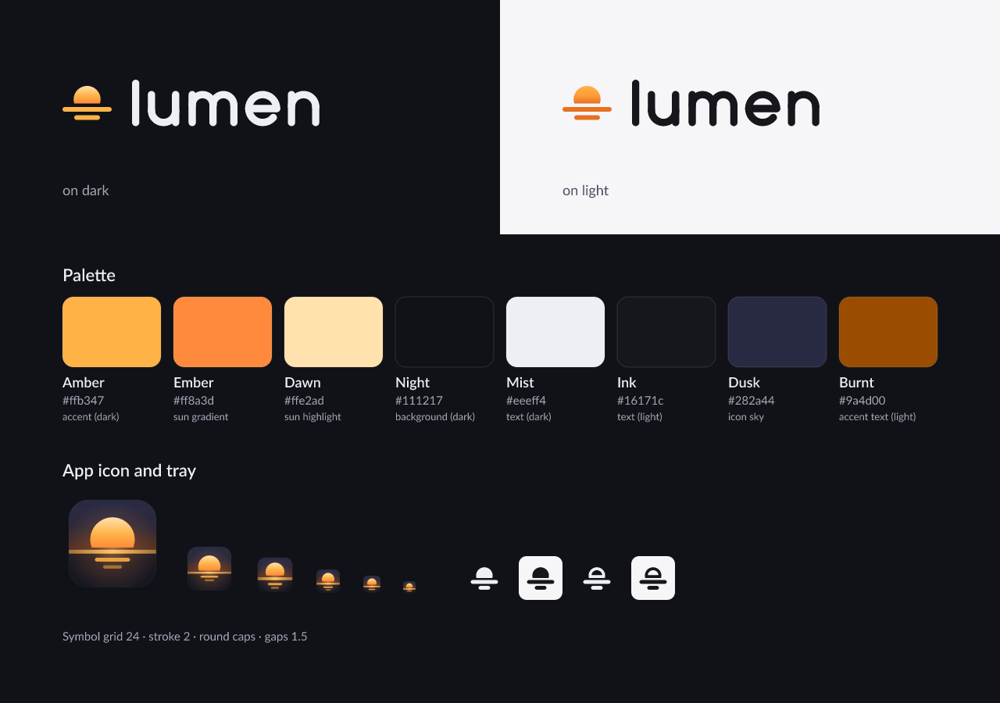

# Lumenwall brand guidelines

How Lumenwall looks and speaks: in the app, the README, packages and anything published about it. The design system in code is `crates/lumenwall-ui/src/theme.rs` (see [UI.md](UI.md)); this document is its reference and proposes the adjustments listed under [Tokens to change](#tokens-to-change-in-lumenwall-ui).



## Files

Every SVG below is generated by [`assets/brand/build.py`](../assets/brand/build.py) from one set of measurements; change the script, not the files (see [Regenerating](#regenerating)).

| Asset | File | Use |
|---|---|---|
| Logo, horizontal | `assets/brand/logo/lumenwall-logo-on-dark.svg`, `-on-light.svg`, `-mono.svg`, `-inverse.svg` | README, website, About dialog |
| Logo, stacked | `assets/brand/logo/lumenwall-logo-stacked-on-dark.svg`, `-on-light.svg` | Square spaces, splash-free covers |
| Symbol | `assets/brand/logo/lumenwall-symbol-color.svg` (dark backgrounds), `-color-light.svg`, `-mono.svg`, `-inverse.svg` | Avatars, favicons, the app sidebar |
| Wordmark | `assets/brand/logo/lumenwall-wordmark-mono.svg`, `-inverse.svg` | Where the symbol is already present |
| App icon | `assets/brand/icon/lumenwall.svg` (master, 64 px and up), `lumenwall-32.svg`, `lumenwall-24.svg`, `lumenwall-16.svg` (small-size masters) | Window, taskbar, menus, packages |
| App icon, raster | `assets/brand/icon/png/lumenwall-{16,24,32,48,64,128,256,512,1024}.png`, `assets/brand/icon/lumenwall.ico` (16–256) | Windows resources, stores |
| Linux icon theme | `packaging/linux/icons/hicolor/<size>/apps/lumenwall.png`, `scalable/apps/lumenwall.svg`, `symbolic/apps/lumenwall-symbolic.svg` (written by `build.py` unless `--no-packaging`) | `Icon=lumenwall` in `.desktop` files |
| Tray, symbolic | `assets/brand/tray/lumenwall-symbolic.svg`, `lumenwall-paused-symbolic.svg` | Linux StatusNotifierItem (`IconName`) |
| Tray, Windows | `assets/brand/tray/png/lumenwall-tray-{white,black}[-paused]-{16,20,24,32}.png` | Notification area at 100–200 % scaling |
| README banner | `assets/brand/banner/lumenwall-banner.svg` / `.png` (1280×640), `lumenwall-banner-fr.*` | README hero, GitHub social preview |

## Positioning

**One line.** Lumenwall plays Wallpaper Engine Workshop scenes on Linux and Windows with a native engine that only works when there is something to show.

**Three promises, in this order** (the order of [PERFORMANCE.md](PERFORMANCE.md)):

1. **Costs almost nothing.** Measured, not claimed: CPU and GPU time per frame, wake-ups, memory, load time. Covered or hidden means no frame.
2. **Plays what you already have.** Scenes, particles, scripts, puppets and text from the Workshop, with the wallpaper's own shaders. Video and web are in progress and are said to be.
3. **Belongs on your desktop.** Native on Wayland, X11 and Windows, GNOME included without an extension; a Rust binary, no webview, no telemetry.

**Audience.** Desktop users and players who want an animated desktop without a manual, and who notice when a background app costs battery or frames.

## Voice and tone

Plain, precise, calm. Lumenwall states what it does, how much it costs, and what it does not do yet.

| Do | Don't |
|---|---|
| Give a number with its conditions: "1.6 % of one core at 30 fps on two 1440p screens (RTX 4080 SUPER)". | "Blazing fast", "ultra-light", "zero impact", "the best". |
| Say what is missing: "Video wallpapers: not yet." | Hide gaps behind "coming soon" without a status. |
| Describe the compatibility nominatively: "plays Wallpaper Engine Workshop wallpapers". | "Wallpaper Engine for Linux", "official", any wording that suggests endorsement. |
| Address the user directly, short sentences, active voice. | Exclamation marks, emoji in UI text, jokes in error messages. |
| Explain the next step in every error: what happened, what to do. | Error codes alone, blame ("you did…"). |

Every published claim must be checkable: a measurement in a crate README, a test, or a status table. When a number changes, the README table changes with it.

### Vocabulary (EN / FR)

The UI ships in English and French (`crates/lumenwall-ui/src/i18n.rs`). Use the same words everywhere.

| English | Français | Notes |
|---|---|---|
| wallpaper | fond d'écran | Never "background" / "arrière-plan" in UI text. |
| scene, video, web | scène, vidéo, web | Wallpaper types. |
| engine | moteur | The engine process. Not "daemon" in the UI (fine in docs). |
| screen | écran | Not "monitor", "display", "output" in the UI (`output` is fine in CLI docs). |
| Apply | Appliquer | The primary action. |
| Library | Bibliothèque | |
| Workshop | Workshop | Steam's name, untranslated. |
| pause / paused | pause / en pause | |
| preview | aperçu | Also used for "not final" (Windows support). |

French follows French typography: non-breaking space before `: ; ? !` and inside `« »`, the typographic apostrophe `’` in images (plain `'` is fine in code and UI strings), "Mo" / "Go" for sizes, decimal comma ("0,5 ms").

### Name

Write **Lumenwall**: one word, capital L only. Never "LumenWall", "Lumen Wall", "Lumen-wall", "LUMENWALL", or "Lumen" alone. The wordmark is lowercase by design.

The technical identifier is **`lumenwall`**, lowercase: binaries, packages, icon names (`Icon=lumenwall`), file names (`lumenwall-*`), configuration directories. Do not combine the name with third-party names ("Lumenwall WE", "SteamLumenwall").

Why not "Lumen": on 2026-11-03 the name was taken where Lumenwall has to live (the `lumenwall` crate and binary on crates.io and the AUR, the `lumenwall` snap, several live-wallpaper projects on GitHub), and searches are dominated by Laravel Lumen and Unreal Engine's Lumen lighting. "Lumenwall" keeps the idea, light on the wall, and was free on crates.io, the AUR, the Snap Store, Flathub and as a GitHub organisation (`lumenwall.dev` unregistered, `lumenwall.app` taken). No trademark search was made.

## Logo

### Concept

The sun at the horizon and its reflection below: light above, calm below. It is the wallpaper (light) on the desktop (the horizon), as the name says (light on the wall), and the reflection is the motion that settles when nobody is looking. It continues the sun-on-the-horizon mark the app already used, simplified to three shapes that stay readable at 16 px.

### Construction

The symbol is drawn on the 24-unit grid of the UI icons (`crates/lumenwall-ui/src/icons.rs`), with the same 2-unit weight and round ends.

| Part | Geometry (24-unit grid) |
|---|---|
| Sun | Disc, centre (12, 10.75), radius 5.75, cut flat at y = 12.5 (the chord lies 0.3 r below the centre; about 65 % of the disc shows) |
| Horizon | Line y = 15, x 2.5 → 21.5, weight 2, round caps |
| Reflection | Line y = 18.5, x 7.5 → 16.5, weight 2, round caps (just under half the horizon) |
| Gaps | 1.5 units between sun and horizon and between horizon and reflection |
| Ink box | x 1.5 → 22.5, y 5 → 19.5 |

The **wordmark** is drawn, not typeset (no font licence involved): lowercase "lumenwall", one stroke weight (2.6 units for an x-height of 12.5 and an ascender of 16.5), round terminals and round vertices. Stroke-to-x-height ratio 0.21, close to the symbol's.

| Glyph | Construction |
|---|---|
| l | One stem to the ascender |
| u, n, m | Geometric arches: stems 8.6 apart for u and n, 7.4 per arch for m; arches spring from the stem |
| e | Circle (radius 4.95) open 40° below a bar that spans the bowl |
| w | Four diagonals 14.4 wide; round vertices on the baseline; the middle apex stops at 85 % of the x-height so the centre of the word does not darken |
| a | Single storey: the e's circle closed against a full-height stem |

Spacing is set by the shape of the facing sides, ink to ink: straight–straight 3.3 units, straight–round 2.7, round–round 2.2, straight–diagonal 1.3, round–diagonal 0.9; pairs with a lone ascender stem (`lu`, `ll`) 3.0. The colour of the word was checked on a blurred rendering (no dark knot at m, e or w) and legibility from 480 down to 80 px wide.

**Horizontal lockup.** Symbol height = 1.3 × the wordmark's ascender, centred on the ascender band; gap between symbol and wordmark = 0.42 × symbol height. **Stacked lockup.** Symbol (2.6×, about half the wordmark's width) centred above the wordmark, gap = 0.75 × x-height.

**Clear space.** At least the wordmark's x-height on every side (the exported SVGs include it). For the symbol alone: 4 units of its grid.

**Minimum sizes.**

| Version | Screen | Print |
|---|---|---|
| Horizontal logo | 120 px wide (wordmark x-height ≈ 8.5 px) | 35 mm wide |
| Stacked logo | 96 px wide | 25 mm wide |
| Wordmark alone | 72 px wide | 20 mm wide |
| Symbol | 16 px (below 24 px use the hinted app icon or tray masters, never a scaled-down master) | 5 mm |

### Colour versions

| Background | Version |
|---|---|
| Dark (Night `#111217` and darker, dark photos) | `on-dark`: sun gradient Dawn → Amber → Ember, lines Amber, wordmark Mist |
| Light (white, `#f6f6f9`) | `on-light`: sun gradient Amber → Ember Deep, lines Ember Deep `#e8711f`, wordmark Ink |
| One colour, light background | `mono`: Ink `#16171c` |
| One colour, dark or busy background | `inverse`: white |

### Don't

- Recolour the symbol outside the palette, or put Amber lines on a light background (contrast 1.8:1).
- Stretch, rotate, outline, add shadows, glows or bevels to the logo (the glow belongs to the app icon's scene only).
- Rebuild the wordmark with a font, change its letter spacing, or capitalise it.
- Change the proportions of the symbol: number, length or order of the lines; sun as a full circle; rays.
- Place the logo over a busy image without the inverse version and a scrim.
- Combine it with the Wallpaper Engine or Steam logos, or use their colours and shapes next to it.
- Use the paused tray state as a logo.

## App icon

A dusk scene in a rounded square: indigo sky warming toward the horizon, a glowing sun, an amber horizon band that runs to the edges of the tile, and two reflections below. It reads at 16 px because the small sizes have their own masters.

| Size | Master | Differences |
|---|---|---|
| 64 px and up, scalable | `icon/lumenwall.svg` (1024 grid) | Tile 896 (64 margin), radius 200 (22 %), glow, two reflections, 2-unit white rim at 8 % opacity |
| 32, 48 px | `icon/lumenwall-32.svg` | Tile 30 (1 px margin), radius 7, horizon and reflections on whole pixels |
| 24 px | `icon/lumenwall-24.svg` | One reflection |
| 16 px | `icon/lumenwall-16.svg` | Full-bleed tile, 2 px horizon, 1 px reflection |

Rules: the icon always keeps its tile (it must stay visible on light and dark panels; the indigo sky separates it from black taskbars); no text, no badge baked in; no platform-specific redraws beyond these masters. Windows uses `lumenwall.ico` (PNG-compressed entries 16, 24, 32, 48, 64, 128, 256). Linux uses the `hicolor` theme under `packaging/linux/icons/` (install to `~/.local/share/icons/hicolor` or `/usr/share/icons/hicolor`).

## Tray icon

Monochrome, drawn on a 16-pixel grid with whole-pixel edges: sun (top at 2.5, chord at 8), horizon rows 9–10, reflection rows 12–13. It follows the panel's colour: the Linux SVGs are symbolic (GNOME recolours `fill`, KDE reads the `ColorScheme-Text` class), and Windows gets white and black PNGs for dark and light taskbars.

| State | Glyph |
|---|---|
| Playing | Solid sun |
| Paused (user, fullscreen, battery, lock) | Sun as a 1.5 px outline |
| Engine stopped or error | Same as paused; the menu says why. No red badge in the tray. |

## Colour

### Brand palette

Amber is a signal, not a surface: the primary action, the selection, the sun. One amber primary button per view.

| Name | Hex | OKLCH | Role |
|---|---|---|---|
| Amber | `#ffb347` | `oklch(82.1% 0.149 72)` | Accent on dark, logo lines, sun |
| Amber Hi | `#ffc46e` | `oklch(85.6% 0.124 75)` | Hover on dark, horizon highlight |
| Dawn | `#ffe2ad` | `oklch(92.4% 0.075 82)` | Top of the sun gradient |
| Ember | `#ff8a3d` | `oklch(75.0% 0.167 51)` | Bottom of the sun gradient |
| Ember Deep | `#e8711f` | `oklch(67.8% 0.170 49)` | Logo lines on light backgrounds (3.1:1 on white) |
| Burnt | `#9a4d00` | `oklch(50.6% 0.126 55)` | Accent text and hover on light (proposed) |
| Night | `#111217` | `oklch(18.3% 0.010 276)` | Dark background |
| Mist | `#eeeff4` | `oklch(95.3% 0.007 277)` | Text on dark |
| Ink | `#16171c` | `oklch(20.6% 0.010 277)` | Text on light, mono logo |
| Dusk | `#282a44` | `oklch(29.6% 0.047 280)` | App icon sky (icon only) |

### UI tokens and contrast

WCAG 2.2 contrast ratios, computed from the sRGB values (relative luminance; semi-transparent colours composited on their real background). Targets: 4.5:1 for text (AA), 3:1 for large text and UI component boundaries. ✗ marks a failure today; the right column is the proposal.

**Dark theme (default)**

| Pair | Today | Ratio | Proposed | Ratio |
|---|---|---|---|---|
| `text` `#eeeff4` on `bg` `#111217` / `raised` `#20232c` | | 16.29 / 13.67 | — | |
| `muted` `#a3a7b7` on `bg` / `raised` | | 7.81 / 6.55 | — | |
| `faint` on `bg` / `raised` (placeholders, hints, shortcut labels) | `#6d7183` | ✗ 3.87 / ✗ 3.24 | `#878c9e` | 5.59 / 4.69 |
| `accent` `#ffb347` on `bg` / `raised` | | 10.50 / 8.81 | — | |
| `accent` on selected nav item (`accent_soft` over `sidebar`) | | 8.53 | — | |
| `on_accent` `#221605` on `accent` / `accent_hover` | | 9.95 / 11.29 | — | |
| `success` `#5cd68d`, `warning` `#f5c542`, `danger` `#ff7a7a` on `bg` | | 10.21, 11.53, 7.41 | — | |
| White on `danger` (error toast, "Not supported" badge) | `#ffffff` | ✗ 2.52 | new `on_danger` `#2a0a0a` | 7.26 |

**Light theme**

| Pair | Today | Ratio | Proposed | Ratio |
|---|---|---|---|---|
| `text` `#16171c` on `bg` `#f6f6f9` / `raised` `#ffffff` | | 16.59 / 17.90 | — | |
| `muted` on `bg` / `sidebar` `#ececf1` | `#5a5d6c` | 6.05 / 5.54 | `#4d5060` (keeps the step to `faint`) | 7.40 / 6.78 |
| `faint` on `bg` / `raised` / `sidebar` | `#8d90a0` | ✗ 2.94 / ✗ 3.17 / ✗ 2.69 | `#676a7b` | 4.96 / 5.35 / 4.54 |
| Accent as text on `bg` / `sidebar` / selected nav | `#b35d00` | ✗ 4.34 / ✗ 3.98 / ✗ 3.53 | new `accent_text` `#9a4d00` | 5.67 / 5.19 / 4.60 |
| White on `accent` (buttons, chips) | `#b35d00` | 4.68 | — | |
| White on `accent_hover` | `#c96a00` | ✗ 3.79 | `#9a4d00` (hover darkens in light mode) | 6.11 |
| `success` on `bg` / `sidebar` | `#1b8045` | 4.61 / ✗ 4.23 | `#187a41` | 4.99 / 4.57 |
| `warning` `#8a6200`, `danger` `#b91c1c` on `bg` | | 5.09, 6.00 | — | |

Other rules:

- Card titles over previews sit on the scrim where it is at least 60 % black (white on 82 % black over mid grey: 17.9:1). Badges on images use the glass style (55 % black: 4.7:1 for white text even over white).
- Status is never colour alone: an icon or a word goes with it (dot + "Engine running").
- Borders (`border` 1.4:1 on dark) are decorative; inputs are identified by their fill, icon and placeholder, and get the accent focus ring (10:1).

## Typography

**UI.** The system font, never embedded: Segoe UI on Windows; on Linux the first installed family with real static weights among Inter, Ubuntu, Lato, Noto Sans, Roboto, Open Sans, Fira Sans, Cantarell, DejaVu Sans (`theme::init_font`). Variable-only families are skipped because iced's text engine sees one face and would fake bold. Weights: regular 400, medium 500, semibold 600.

| Token | Size (px) | Weight | Use |
|---|---|---|---|
| `DISPLAY` | 28 | semibold | Page titles |
| `TITLE` | 20 | semibold | Panel title, empty-state titles |
| `HEADING` | 15.5 → **16** (proposed) | semibold | Card and section headings |
| `BODY` | 14 | regular / medium | Default |
| `CAPTION` | 12.5 | regular | Metadata, hints |
| `MICRO` | 11 | medium, uppercase sections | Badges, section labels |

**Brand images** (banner, social preview, brand sheet): Lato (SIL Open Font License 1.1), converted to outlines by `build.py`, so neither the SVGs nor the PNGs depend on installed fonts and no font file is distributed. Lato is also what the Linux screenshots show when Inter is absent. Code and command lines in docs: the reader's monospace font.

**Licence check (`deny.toml`).** `[licenses] allow` has no `OFL-1.1`, and that is fine today: no font ships in a binary. Embedding Inter or Lato (both OFL-1.1) would need:

- through a crate that packages the font and declares `OFL-1.1`: add `OFL-1.1` to `allow` (or an `exceptions` entry for that crate), otherwise `cargo deny check licenses` fails;
- through `include_bytes!` in a workspace crate: cargo-deny would not see it (workspace crates are ignored), but the obligations are the same, so add the exception anyway for the record;
- in both cases: ship the font's copyright notice and the OFL text with the binary, and do not subset or modify a font that has a Reserved Font Name without renaming it.

## Iconography

UI icons live in `crates/lumenwall-ui/src/icons.rs` and are drawn for Lumenwall.

- 24 × 24 grid, live area 20 × 20 (2 units of padding), outline style, 2-unit stroke, round caps and joins, corner radius 2. Solid shapes only for media controls (play, pause, volume) and filled status marks.
- One metaphor per icon, no text inside, no perspective. Tinted at draw time with the text tokens (`muted` by default, `accent` when active).
- Never third-party logos: Steam and Wallpaper Engine actions use words plus the generic "external" icon.
- Sizes in use today: 12, 13, 14, 15, 16, 18, 20, 26, 28 px. Proposed: **14** (status bar, dense rows), **16** (buttons, chips), **20** (navigation), **24** (headers), and 28 for the brand mark only. Fewer sizes, and the 2-unit stroke lands on 1.17–2 px.
- The sidebar logo (`Icon::Logo`) becomes the new symbol (paths in `assets/brand/logo/lumenwall-symbol-mono.svg`, same grid).

## Spacing, radii, elevation

The current scales work and stay; the proposals add what the views currently hard-code.

| Scale | Values |
|---|---|
| Spacing (`space`) | 4 · 8 · 12 · 16 · 24 · 32 |
| Radius (`radius`) | 6 (monitors, swatches) · 10 (buttons, inputs, notices) · 14 (cards, previews) · pill (chips, badges, search) |
| Elevation | 1: y 1, blur 4, 28 % black · 2: y 6, blur 18, 34 % · 3: y 14, blur 36, 42 % (×0.45 in light theme) |

### Tokens to change in `lumenwall-ui`

| Token today | Proposed | Why |
|---|---|---|
| `DARK.faint` `#6d7183` | `#878c9e` | Placeholder and hint text fails AA (3.24:1 on raised) |
| `LIGHT.faint` `#8d90a0` | `#676a7b` | 2.69–3.17:1 |
| `LIGHT.muted` `#5a5d6c` | `#4d5060` | Keeps `muted` visibly darker than the new `faint` |
| `LIGHT.accent_hover` `#c96a00` | `#9a4d00` | White label on hover fails (3.79:1); in light mode hover darkens |
| — | `accent_text`: dark `#ffb347`, light `#9a4d00` | Accent used as text (nav selection, links, "On screen" labels) fails AA in light (3.53–4.34:1) |
| — | `on_danger`: dark `#2a0a0a`, light `#ffffff` | Error toast and red badges use white on `#ff7a7a` in dark (2.52:1) |
| `LIGHT.success` `#1b8045` | `#187a41` | 4.23:1 on the sidebar |
| `size::HEADING` 15.5 | 16 | On the 4 px rhythm (16/24 line), same visual weight |
| Icon sizes 12–28 (9 values) | `icon::S 14`, `M 16`, `L 20`, `XL 24` | Consistent stroke weight |
| — | `motion::FAST 100 ms`, `BASE 200 ms`, `PANEL 220 ms`, `SLOW 320 ms` | Named durations (below) |
| `icons::logo_rgba` (procedural, amber, 32/64 px) | Decode `assets/brand/icon/png/lumenwall-{32,64}.png` for the window icon; tray uses `IconName = "lumenwall-symbolic"` (paused: `lumenwall-paused-symbolic`) when installed, else the `tray/png` glyphs | Same mark everywhere, monochrome tray |

## Motion

Motion explains a change; it never decorates. Durations match iced's `Animation` presets.

| Token | Duration | Easing | Used for |
|---|---|---|---|
| `FAST` | 100 ms | ease-out | Press, small colour changes |
| `BASE` | 200 ms | ease-in-out (iced default) | Hover wash in/out, chips, toggles |
| `PANEL` | 220 ms | ease-out entering, ease-in leaving | Details panel slide |
| `SLOW` | 320 ms | ease-in-out | Toasts, drag ghost settling |

Rules:

1. **Nothing moves, nothing runs.** An animation exists only while it plays: the tick subscription is created when it starts and dropped when it ends (as `hover_in` / `hover_out` / `panel` do today). No idle loops, no shimmer placeholders, no spinners while waiting on a blocking call that has no progress.
2. Previews animate only as the user chose (Settings: visible cards / on hover, the default / never). A hidden or minimised window animates nothing.
3. Honour the system's "reduce animations" setting (GNOME `org.gnome.desktop.interface enable-animations`, KDE animation speed, Windows "Animation effects"): durations drop to 0.
4. No motion in the logo or the app icon. No splash screen.

## Empty and error states

Each state has an illustration, a one-line title, one sentence of explanation and at most two actions (the first one primary). Illustrations live in `icons.rs` (`Illustration`).

- 160 × 130 view box, displayed at 176 × 143 px; 3-unit strokes, round caps.
- Three colours from the tokens: `overlay` fills, `muted` outlines, one `accent` element that carries the meaning (the sun, the magnifier, the plug spark).
- Objects only (screens, cards, folders, plugs, the sun): no characters, no photos, no Workshop artwork, no Steam or Wallpaper Engine imagery.
- The sun motif marks "this is where a wallpaper will be"; problems use the alert triangle in `warning` or `danger`, never a sad face.

| State | Illustration | Title (EN / FR) |
|---|---|---|
| No wallpaper yet | Screen with the rising sun | "No wallpapers yet" / « Aucun fond d’écran pour l’instant » |
| Search or filters match nothing | Magnifier over cards | "No wallpaper matches" / « Aucun fond d’écran ne correspond » |
| Engine not running | Unplugged plug | "Engine not running" / « Moteur arrêté » |
| No Steam library found | Folder (proposed; today the plug) | "Steam was not found" / « Steam est introuvable » |

## Screenshots

- Only the generated demo library: `lumenwall-ui --demo-library --fake-daemon` (blurred colour fields, invented titles). Never Workshop previews or Wallpaper Engine content (copyrighted by their authors, see [TESTING.md](TESTING.md)).
- Window 1360 × 860, scale 1, `--screenshot <file.png>`; PNG; one file per page, theme and language: `<page>-<theme>-<lang>.png` in `docs/ui-screenshots/`.
- English screenshots in the English README, French in the French one. Dark theme first (default), at least one light.
- No personal data: user name, home path, Steam account, real monitor serials. Paths are `~`-shortened in the UI; check the "No Steam found" state before publishing it.
- Retake them when a view changes; a screenshot that shows an older UI is a bug.

## Regenerating

```bash
cargo install resvg usvg            # 0.45; once
python3 assets/brand/build.py       # SVG, PNG, ICO, packaging/linux/icons, banner, brand sheet
python3 assets/brand/build.py --no-packaging   # same, without touching packaging/
python3 assets/brand/build.py --svg-only   # without the tools: logo, icon and tray SVGs only
```

The name lives in two constants at the top of the script (`ID = "lumenwall"` for file names, `NAME` for titles); the wordmark's glyphs and spacing are in `wordmark_glyphs()` and `WM_GAPS`. `usvg` converts the banner text to outlines and needs the Lato font installed (`fonts-lato` on Debian/Ubuntu). Pillow, if present, measures the banner chip widths. Check the PNGs at 100 % after any change, especially 16 and 24 px.

## Licence and use of the name

The brand files are part of the repository and are licensed like the code (MIT OR Apache-2.0). The name and logo are not registered trademarks; use them to refer to Lumenwall (articles, packages, forks that say they are forks), not to suggest an official build or endorsement. Packagers may use the icon unchanged.

Wallpaper Engine and Steam names and logos belong to their owners. Lumenwall's brand does not use, imitate or sit next to them.
